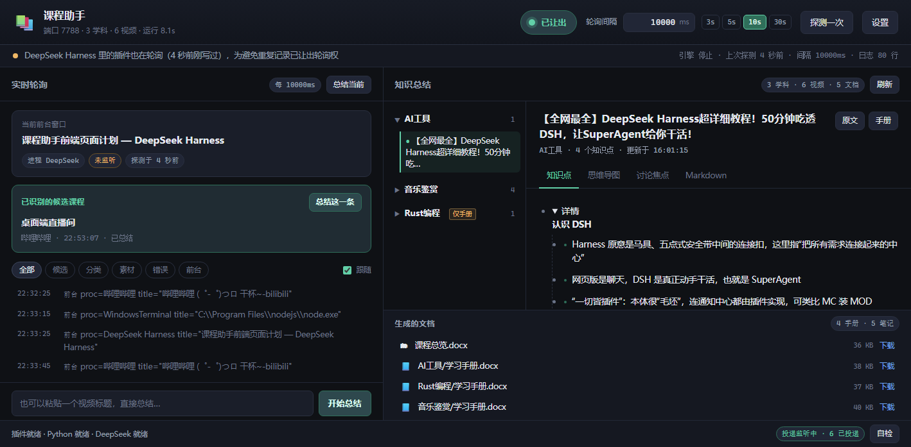
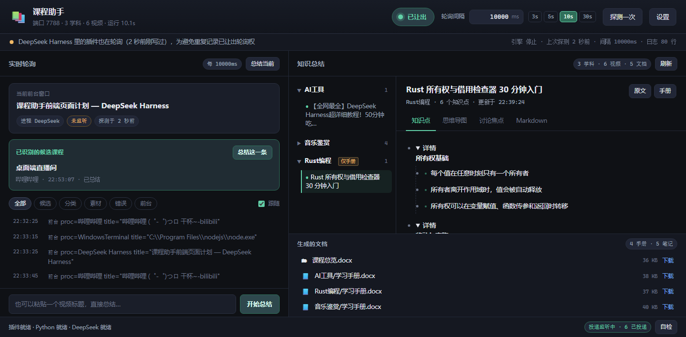
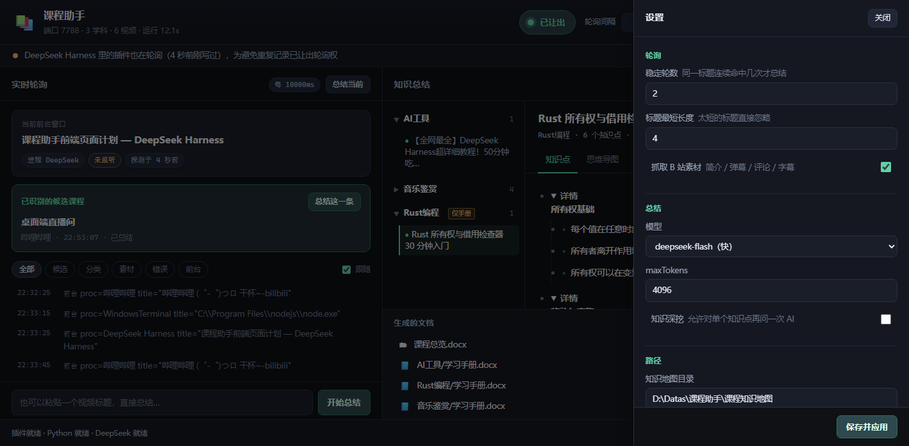

# 课程助手 · Course Assistant

> 你在 B 站看课程视频，它在后台认出来，抓弹幕和评论，让 AI 写一份知识总结，顺手变成 Word 文档和学科手册。

一个**不需要启动任何托管平台**的本地桌面小应用：双击就能跑，界面在浏览器里，数据全在你自己电脑上。



---

## 它解决什么问题

看网课最大的浪费不是看，是看完就忘。手动做笔记要暂停、切窗口、敲字，几次之后就放弃了。

这个工具的思路是**把记录这件事从你的操作里摘出去**：

1. 它轮询你的**前台窗口标题**（比如「Rust 所有权与借用检查器 30 分钟入门_哔哩哔哩_bilibili」）
2. 标题稳定几轮之后，交给 LLM 判断「这是不是课程、属于哪个学科、标题怎么清洗」
3. 认定是课程，就去 B 站抓这条视频的**简介、弹幕、评论**（有字幕也会抓）
4. 把这些素材喂给 LLM，产出**核心知识点 / 弹幕讨论焦点 / 思维导图**
5. 追加到该学科的**学习手册**，同时生成一份独立的 **Word 笔记**

你只需要照常看课。看完切回浏览器，总结已经在那儿了。

## 界面

三个面板，一屏看完：

| 左栏 · 实时轮询 | 右栏 · 知识总结 |
| --- | --- |
| 当前前台窗口与进程名、已识别的候选课程、按类型分色的轮询日志流 | 学科树 → 视频列表 → 笔记四种视图：核心知识点、思维导图、讨论焦点、Markdown 原文 |

顶部是**电源开关**和**轮询间隔**（2000–120000 ms，带 3s/5s/10s/30s 预设），底部是环境自检与文档列表。

### 思维导图是渲染出来的，不是贴图

mermaid mindmap 被解析成 DOM 树，可以点开收起：



### 设置抽屉

稳定轮数、标题最短长度、模型、maxTokens、输出目录、插件路径、Python 路径都能改：



## 快速开始

### 环境要求

- **Windows**（读前台窗口标题用 Win32 API，其他平台需要改 `lib/engine.mjs` 的 `probeForeground`）
- **Node.js ≥ 20**
- **Python 3** 且装了 `python-docx`（`pip install python-docx`）——只用来把 Markdown 转成 `.docx`
- 一个 **DeepSeek API Key**

### 三步跑起来

```powershell
git clone https://github.com/YAs-101/course-assistant.git
cd course-assistant
node app/main.mjs --open
```

浏览器会打开 `http://127.0.0.1:7788`。**不需要 `npm install`**——本项目零第三方依赖。

### 配 API Key

应用按这个顺序找密钥，任一满足即可：

1. `app/config.json` 里的 `apiKeyFile` 指向的文件，内容形如 `DEEPSEEK_API_KEY: sk-xxxx`
2. `~/.dsh/.credentials.yaml` 里的 `DEEPSEEK_API_KEY`（如果你装过 DeepSeek Harness）

密钥**不会**写进 `config.json`，也不会显示在页面上。找不到时应用仍可运行，只是总结功能降级为「只抓素材不写总结」。

### 桌面快捷方式（可选）

```powershell
powershell -NoProfile -ExecutionPolicy Bypass -File app/scripts/make-shortcut.ps1
```

之后双击桌面上的「课程助手」即可。删掉用 `-Uninstall`。

> 快捷方式指向 `wscript.exe` + `app/启动课程助手.vbs`，所以启动时**不弹黑窗**，关闭浏览器页面也不会杀掉后台服务。

### 作为 DSH 插件用（可选）

如果你在用 [DeepSeek Harness](https://github.com/deepseek-ai/deepseek-harness)，`plugins/dsh-course-bridge/` 是与之配套的投递插件：把生成的笔记**投递到一个新的 DSH 会话**里，由 agent 继续加工。详见 [`plugins/dsh-course-bridge/README.md`](plugins/dsh-course-bridge/README.md)。

---

## 工作原理

```
前台窗口标题
   ↓  poll.ps1（PowerShell + Win32 GetForegroundWindow）
   ↓  浏览器进程白名单过滤（哔哩哔哩 / chrome / msedge / potplayer …）
   ↓  清洗标题后缀、去重、长度校验
   ↓  稳定 N 轮（默认 2 轮）—— 防止切窗口时误触发
LLM 分类：这是课程吗？哪个学科？标题怎么清洗？
   ↓
B 站素材：搜索 → 取视频详情 → 弹幕 / 评论 / 字幕
   ↓
LLM 总结：核心知识点 · 弹幕讨论焦点 · 思维导图
   ↓
Markdown 手册（按学科累积）+ Word 笔记（单视频）
   ↓
界面实时读取磁盘文件并渲染
```

**关键设计：所有状态都在磁盘上，进程随时可以死。** 应用本身不维护内存真相——它读 `state.json`、`manuals/*.md`、`poll.log`，然后渲染。所以你关掉页面、重启应用，甚至直接用文本编辑器改手册，界面都会如实反映。

## 输出文件在哪

默认是 `app/` 的兄弟目录 `课程知识地图/`（可在设置里改）：

```
课程知识地图/
├── 课程总览.docx              所有学科的汇总大纲
├── <学科>/
│   └── 学习手册.docx          该学科累积的手册
├── 笔记/
│   └── 笔记-<标题>-<时间>.docx 单个视频的总结
└── .state/
    ├── state.json             已识别的学科与视频
    ├── manuals/<学科>.md      手册的 Markdown 源（界面读它）
    ├── index.md               总览的 Markdown 源
    ├── poll.log               轮询日志（界面读它）
    ├── poll.ps1               读取前台窗口的 PowerShell 脚本
    ├── bridge.json            投递账本（仅在用 DSH 投递时有内容）
    ├── bridge.heartbeat.json  投递心跳
    └── bridge.log             投递日志
```

> 界面的学科树以**磁盘上实际存在的手册**为准。如果 `state.json` 少了某个学科（多个轮询者互相覆盖时会这样），手册还在的话仍会列出来并标上「仅手册」。

## 和 DeepSeek Harness 里课程插件的关系

两者用的是**同一套插件代码**（都来自上游 `dsh-video-coursemap`）和**同一份知识地图目录**。所以：

- 应用启动时会检查「这份知识地图最近有没有别人在写」。检测到 DSH 里的插件正在轮询，应用**不自动启动**，状态条显示「已让出轮询权」，避免同一个视频被记录两遍。
- 想手动接管，点一下电源开关即可（会提示重复记录的风险）。
- 反过来，如果你在用这个应用轮询，建议到 DSH 那边关掉课程插件，或者让它指向别的输出目录。

一句话：**两个都能用，但同时开轮询会打架。想省心就只开一个。**

## 已知问题

- `poll.ps1` 单次调用约 **1.5–1.7 秒**（PowerShell 启动 + `Add-Type` 编译）。这就是轮询间隔下限设为 2000ms 的原因，设更短只会让探测排队。
- 标题含 emoji 时，早期转 docx 会因 GBK 编码报错。应用启动第一件事就设 `PYTHONIOENCODING=utf-8` 修好了；绕过应用直接调 `md2docx.py` 则需自己保证该变量。
- `.state/poll.log` 不随每次轮询增长：同一「进程+标题」只记一次。所以「日志没变」不等于「没在轮询」，要确认请用界面的「探测一次」。
- **后台播放识别不到**（浏览器窗口不在前台）——Windows 前台窗口检测的固有限制。
- 多数 B 站视频没有字幕，此时总结完全依赖简介 + 弹幕 + 评论；弹幕匿名接口上限 120 条、评论 30 条。
- 只测过 Windows 10/11。macOS/Linux 需要重写 `probeForeground`。

## 开发

```powershell
cd app
node --test "test/*.test.js"    # 233 项测试
```

```
app/
├── main.mjs              入口：编码、抢锁、选端口、自检、优雅退出
├── server.mjs            node:http 服务、全部 API、SSE、静态文件、路径沙箱
├── lib/
│   ├── config.mjs        配置读写与逐项校验、热改/重建的键划分
│   ├── engine.mjs        伪造宿主上下文、加载插件、启停重建、前台探测
│   ├── llm.mjs           DeepSeek 流式客户端
│   ├── store.mjs         读知识地图：state / 手册切分 / 笔记列表 / bridge 账本
│   ├── logs.mjs          poll.log 解析与归类
│   ├── deepsplit.mjs     笔记结构化、思维导图解析、知识点展开
│   ├── paths.mjs         目录定位、插件发现（含内置 vendor）、越界校验
│   └── python.mjs        Python 解释器探测
├── public/
│   ├── index.html        页面骨架
│   ├── app.js            交互与渲染（纯 DOM，无框架）
│   ├── md.js             手写 Markdown + mindmap → HTML
│   └── app.css           深色主题
├── vendor/
│   └── dsh-video-coursemap/   内置的上游插件（MIT）
├── scripts/make-shortcut.ps1  桌面快捷方式
├── 启动课程助手.vbs           wscript 静默启动器（UTF-16LE）
└── test/                 8 个测试文件
```

**怎么让它脱离 DSH 跑起来**：上游插件导出的是 `apply(ctx, config)`，需要宿主提供 `ctx.llm.stream`、`ctx.tools.register`、`ctx.effect`、`ctx.get('agentDefaultModel')`。`lib/engine.mjs` 的 `createFakeContext()` 就伪造了这四样——`llm.stream` 直连 DeepSeek HTTP API，其余用内存对象顶替。于是同一份插件代码在普通 Node 进程里就能工作。

## 附带小工具

`tools/` 下是跟课程助手无关、但同一套风格（Node 标准库、零第三方依赖、纯函数优先测试）写的独立小工具，各自有自己的 README 和测试命令。

- [`tools/rewards-auto/`](tools/rewards-auto/README.md) —— 每天登录 Windows 后自动打开 Edge 把 Microsoft Rewards 当日搜索积分刷满再关掉浏览器。靠 CDP 驱动真实 profile，窗口最小化不打扰人。需要 Node ≥22。

## 许可

本项目 MIT，见 [`LICENSE`](LICENSE)。

内置的 `app/vendor/dsh-video-coursemap` 归上游作者所有，同样是 MIT，版权声明与来源见 [`THIRD-PARTY-NOTICES.md`](THIRD-PARTY-NOTICES.md)。
